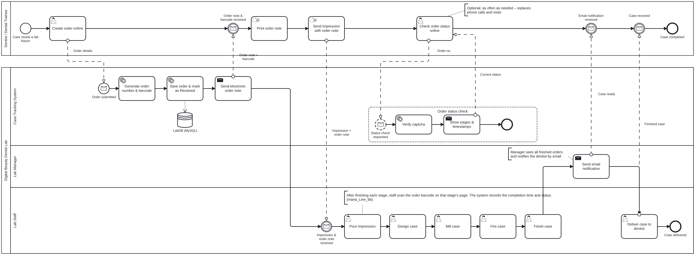

# Case Tracking System — Digital Beauty Dental Lab

A simple web-based system for tracking dental lab orders (cases) through every production stage, from the moment an order is received until it is delivered.

Built in 2020 by **Mohammad Haddad** as the practical outcome of a cooperative training (Co-op) period at *Digital Beauty Dental Lab* in Al-Hasa, Saudi Arabia — Management Information Systems, School of Business.

---

## Background

Digital Beauty Dental Lab produces dental fixtures (crowns, bridges, etc.) for dentists across the Eastern Province. A large share of its customers were **dental trainees from King Faisal University**, and their orders caused recurring problems:

- **Frequent phone calls** — trainees called the lab repeatedly to ask about the status of their orders.
- **Frequent visits** — trainees visited the lab in person far more often than other customers, for the same reason.
- **Missing order notes** — orders often arrived without proper notes, since there was no coordinator to help trainees manage them.

The timing (COVID-19, spring 2020) made reducing in-person visits especially important, alongside the general goal of improving the lab's efficiency and letting staff work without constant interruptions.

## Solution

A lightweight web application where orders are created electronically, every order gets a barcode, lab staff update the order's stage by scanning that barcode, and customers can check their order status online at any time instead of calling or visiting.

## Features

| Feature | Description |
|---|---|
| **Create order** | Customers place orders electronically: patient, dentist, work type, shade/color, teeth per quadrant, notes, and due date. |
| **Auto-generated order number** | The system generates the order number automatically, so customers enter less information. |
| **Electronic order note** | A printable order note that can also be saved as PDF. |
| **Barcode** | Each order gets a Code 128 barcode, so staff can update its status quickly by scanning. |
| **Production-line tracking** | Each stage records a timestamp when the order passes through it. |
| **Status checker** | Customers check their order's current stage online, in real time (protected by a captcha). |
| **Email notification** | The lab manager can email the dentist about updates on their order. |

## Process model (BPMN)

The end-to-end process — from the dentist placing an order, through every production stage in the lab, to delivery — modelled in BPMN 2.0:



The editable source is [`docs/case_tracking_process.bpmn`](docs/case_tracking_process.bpmn). Open it in [bpmn.io](https://demo.bpmn.io) or Camunda Modeler to view or edit it.

## Production stages

Orders move through the lab's production line, with one page per stage:

```
Received → Impression Pouring → Designing → Milling → Firing → Finishing → Delivered
```

| Stage | Page |
|---|---|
| Order received / created | `index.php` |
| Impression pouring | `Pouring.php` |
| Designing | `Designing.php` |
| Milling | `Milling.php` |
| Firing | `Frilling.php` |
| Finishing | `Finshing.php` |
| Delivered | `Delivered.php` |

Other pages:

| Page | Purpose |
|---|---|
| `Check_Status.php` | Public order status checker |
| `orderReport.php` | Full order report / printable order note |
| `emailnot.php` | Send email notification to the dentist |
| `barcode.php` | Barcode image generator |
| `captcha.php` | Captcha image for verification |

## Tech stack

- **Backend:** PHP (PDO)
- **Database:** MySQL / MariaDB
- **Frontend:** HTML, Bootstrap, jQuery, DataTables, Font Awesome
- **Email:** PHPMailer over SMTP

## Database

The schema and sample data are in [`LabDB.sql`](LabDB.sql):

| Table | Contents |
|---|---|
| `order_tbl` | Orders: order number, patient, teeth per quadrant, notes, due date, client, type, color |
| `mana_Line_tbl` | Production line: timestamp and status of every stage for each order |
| `client_tbl` | Clients (dentists / complexes) with email and mobile |
| `type_tbl` | Types of work |
| `color_tbl` | Shades / colors |
| `user_tbl` | Lab staff users |

## Running locally

1. Install a PHP + MySQL environment (e.g. XAMPP, MAMP, or LAMP).
2. Copy the project into your web root and extract the three archives in place:
   - `assets.zip` → `assets/` (CSS, JS, fonts)
   - `includes.zip` → `includes/` (database config)
   - `contact.zip` → `contact/` (PHPMailer and email config)
3. Create a database named `LabDB` and import `LabDB.sql`.
4. Adjust the database credentials in `includes/config.php` if needed (defaults: `root` with no password on `localhost`).
5. For email notifications, set your SMTP details in `contact/config.php`.
6. Open `http://localhost/<project-folder>/` in your browser.

## Project status

This is a **prototype** built during a training period, and it handles trainee orders only. It was originally hosted on InfinityFree, with separate sites for dentists and for lab staff.

Ideas proposed for the future:

- Add a QR code to the electronic order note, so dentists can scan it with their phone and see status updates immediately.
- For the lab as a whole, adopt a full ERP system (Odoo was recommended: open source, low cost, cloud-hosted, with many integrated modules) and adjust some business processes around it.

## Author

**Mohammad Haddad** — Management Information Systems
Co-op supervisor: Dr. Khaled Al-Barak

*Originally published at `github.com/haddad33/case_tracking_system`.*
